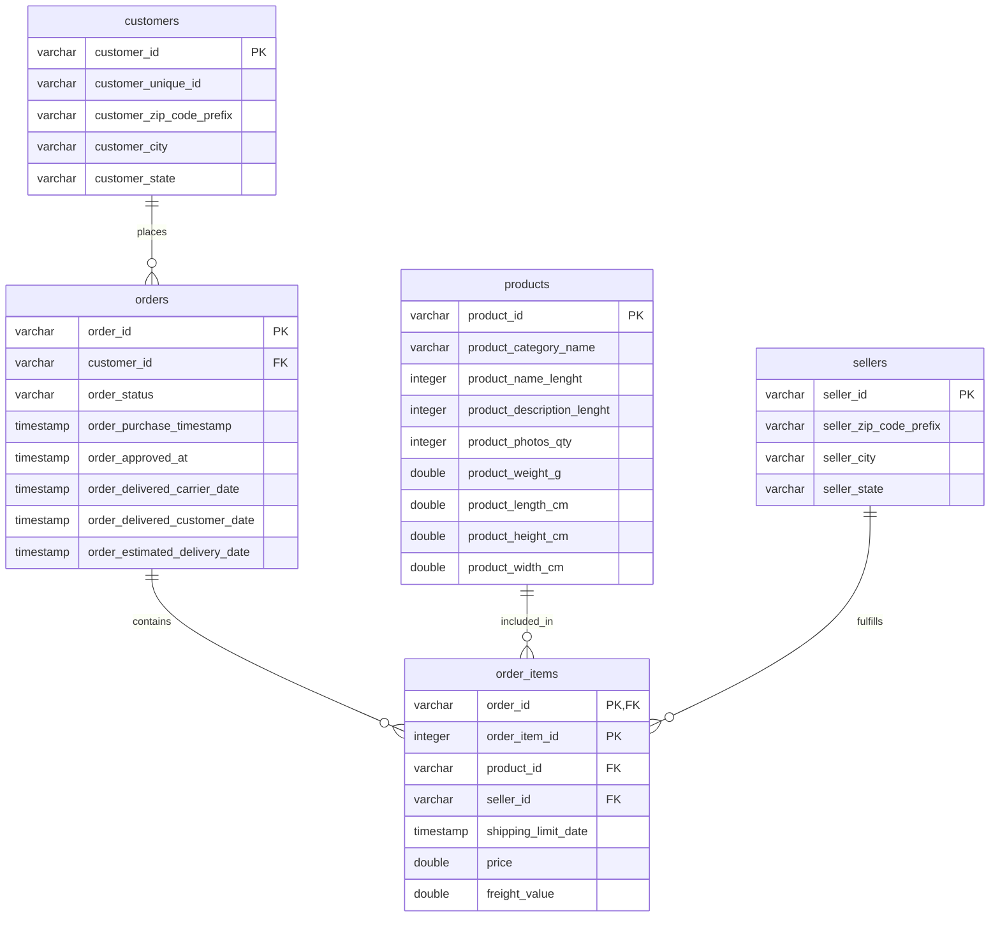

# KDDM Lab

This project sets up an Olist e-commerce data warehouse assignment with DuckDB and Python.

## What is included

- A Python package at `src/kddm_lab` with project utilities for file discovery and DuckDB setup
- A reusable loader for the source Olist CSV files
- A `data/` folder layout for raw CSV inputs and the local DuckDB warehouse
- A notebook scaffold for the assignment work at `DWH_OLAP_Assignment_1_Notebook.ipynb`

## Expected source data layout

Place the source CSVs in:

- `data/raw/olist_customers_dataset.csv`
- `data/raw/olist_orders_dataset.csv`
- `data/raw/olist_order_items_dataset.csv`
- `data/raw/olist_products_dataset.csv`
- `data/raw/olist_sellers_dataset.csv`

## Quick start

```bash
# from the project root
python -m kddm_lab
```

This creates the required folder structure and confirms the project is set up correctly.

## Loader usage

```python
from pathlib import Path
from kddm_lab.loader import build_duckdb_connection, load_olist_raw

con = build_duckdb_connection()
row_counts = load_olist_raw(con)
print(row_counts)
```

## Star schema ETL

```python
from kddm_lab.loader import build_duckdb_connection
from kddm_lab.warehouse import build_and_validate_star_schema

con = build_duckdb_connection()
row_counts, validation = build_and_validate_star_schema(con)
print(row_counts)
print(validation.to_string(index=False))
```

You can also run the ETL directly:

```bash
python -m kddm_lab.warehouse
```

## ERD summary


